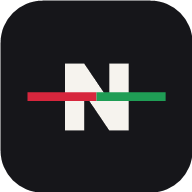
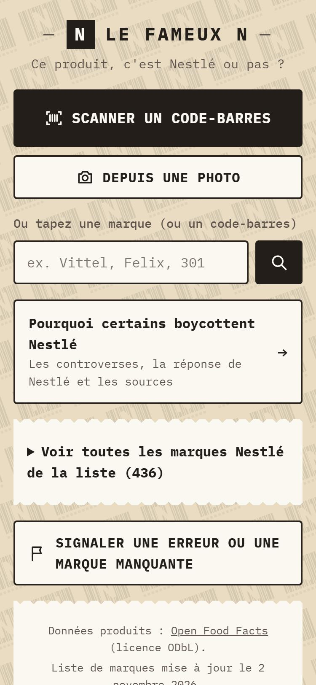
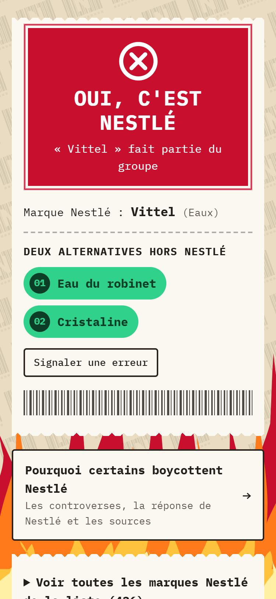
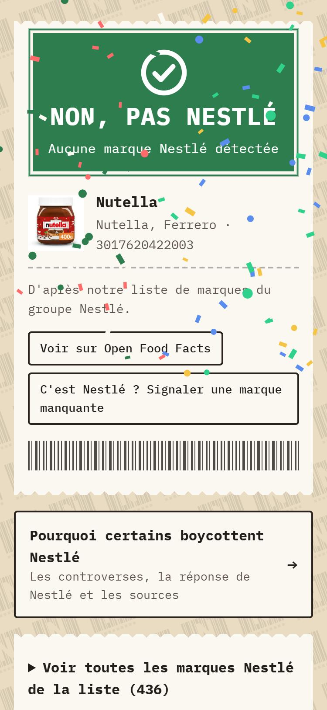

<p align="center">
  
</p>

<h1 align="center">Le fameux N</h1>

<p align="center">
  <strong>Ce produit, c'est Nestlé ou pas ?</strong><br>
  Scanne un code-barres et découvre en une seconde si le produit appartient au groupe Nestlé.
</p>

<p align="center">
  👉 <a href="https://solutioninformatique.github.io/Le-Fameux-N/"><strong>Ouvrir l'application</strong></a> 👈<br>
  <sub>Gratuite, sans compte, sans publicité. Fonctionne sur Android et iPhone.</sub>
</p>

<p align="center">
  
  &nbsp;
  
  &nbsp;
  
</p>

---

## Pourquoi cette app ?

Nestlé possède plus de 2 000 marques dans le monde, et son nom n'apparaît pas toujours sur l'emballage : Vittel, Perrier, Felix, KitKat, Chocapic, Maggi, Nespresso… Pas facile de savoir ce qu'on achète.

Le fameux N te le dit, que tu veuilles boycotter le groupe ou simplement savoir.

## Comment ça marche

1. **Scanne** le code-barres d'un produit avec la caméra, ou choisis une photo.
2. **Ou tape** le nom d'une marque (ou le code-barres).
3. **Lis le ticket** :

| Résultat | Signification |
|---|---|
| 🔴 **Oui, c'est Nestlé** | La marque appartient au groupe. L'app propose deux alternatives hors Nestlé. |
| 🟠 **Ça dépend** | Nestlé seulement dans certains pays, sous licence, ou plusieurs marques portent ce nom. |
| 🟢 **Non, pas Nestlé** | Aucune marque Nestlé détectée (ou une ancienne marque vendue depuis). |
| ⚪ **Impossible à dire** | Produit inconnu ou marque non renseignée. |

Les informations sur les produits viennent d'[Open Food Facts](https://world.openfoodfacts.org), la base de données alimentaire collaborative et libre. La liste compte plus de 430 marques Nestlé, dans tous les pays.

## Installer l'app sur ton téléphone

Ouvre [le lien](https://solutioninformatique.github.io/Le-Fameux-N/), puis :

- **Android (Chrome)** : menu ⋮ › « Ajouter à l'écran d'accueil ».
- **iPhone (Safari)** : bouton Partager › « Sur l'écran d'accueil ».

L'app s'ouvre alors comme une vraie application, et la recherche par marque fonctionne même sans réseau.

## Pourquoi certains boycottent Nestlé

L'app contient une page qui résume les principales controverses (lait infantile, eaux en bouteille, travail des enfants dans le cacao…), avec à chaque fois **la réponse de Nestlé et les sources** : [lire la page](https://solutioninformatique.github.io/Le-Fameux-N/pourquoi.html).

## Une erreur ? Une marque manquante ?

Les marques changent souvent de propriétaire (ventes, licences, coentreprises). Si tu repères une erreur :

- utilise le bouton **« Signaler »** sous chaque résultat dans l'app,
- ou [ouvre un ticket ici](https://github.com/SolutionInformatique/Le-Fameux-N/issues/new), **avec un lien qui prouve ce que tu avances**.

Chaque signalement est vérifié avant correction.

## À savoir

- Application **indépendante**, sans aucun lien avec Nestlé. Les marques citées appartiennent à leurs propriétaires respectifs.
- L'app ne collecte aucune donnée : pas de compte, pas de statistiques de visite. Le code-barres scanné est envoyé à Open Food Facts pour trouver le produit ; la police et la librairie de scan sont chargées depuis Google Fonts et jsDelivr.
- La liste de marques est indicative et datée : en cas de doute, vérifie sur l'emballage.

---

<details>
<summary><strong>Pour les contributeurs : mettre à jour la liste et le site</strong></summary>

### Fichiers

Site statique en HTML, CSS et JavaScript, sans framework, hébergé sur GitHub Pages. Le scan utilise [html5-qrcode](https://github.com/mebjas/html5-qrcode) (moteur ZXing).

| Fichier | Rôle |
|---|---|
| `index.html`, `app.js`, `style.css` | L'application |
| `pourquoi.html` | La page des controverses |
| `marques-nestle.json` | La liste des marques |
| `config.js` | Le dépôt qui reçoit les signalements |
| `sw.js` | Le mode hors ligne (service worker) |
| `flammes.svg`, `motif-codes.svg`, `icon-*.png` | Les images |

### Mettre à jour la liste des marques

Tout est dans [`marques-nestle.json`](marques-nestle.json) :

```json
{ "nom": "Vittel", "categorie": "Eaux", "alternatives": ["Eau du robinet", "Cristaline"] }
```

| Champ | Rôle |
|---|---|
| `nom` | Nom affiché (les accents et la casse sont ignorés pour la comparaison). |
| `categorie` | Groupe dans la liste « Voir toutes les marques ». |
| `alias` | *(optionnel)* Autres écritures : `["kit kat", "kitkat"]`. |
| `exact` | *(optionnel)* `true` pour les noms courts ou ambigus (« Lion », « Polo ») : la marque doit correspondre en entier. Sinon « Nescafé Gold » est reconnu grâce à « Nescafé ». |
| `note` | *(optionnel)* Précision affichée sous le résultat (licence, coentreprise, pays…). |
| `alternatives` | *(optionnel)* Deux produits hors Nestlé proposés quand le résultat est rouge. |
| `pays` | *(optionnel)* Où la marque est vendue, pour les marques étrangères : `"Pérou"`. |
| `partiel` | *(optionnel)* `true` si la marque n'est Nestlé que sous licence ou dans certains pays : résultat orange. |
| `ambigu` | *(optionnel)* `true` pour un nom porté par d'autres marques (« Tango », « Club »…). Au scan, la marque ne compte que si Nestlé apparaît aussi comme propriétaire du produit ; en recherche manuelle, résultat orange. |

Autres sections du fichier :

- `anciennes` : marques vendues par Nestlé (Herta, Quézac, Butterfinger…), affichées en vert avec la mention « Ancienne marque Nestlé ».
- `alternativesParCategorie` et `alternativesParDefaut` : alternatives utilisées quand une marque n'a pas les siennes.
- `conseilsAlternatives` : une phrase par catégorie (ex. demander conseil au pédiatre pour le lait infantile).
- `proprietaires` : mots-clés cherchés dans le champ « propriétaire » d'Open Food Facts (ex. « Nestlé France »).

La liste reprend la [liste Wikipédia des marques Nestlé](https://en.wikipedia.org/wiki/List_of_Nestl%C3%A9_brands), corrigée quand une vente est connue. Penser à changer `miseAJour`. Une modification de la liste seule n'a pas besoin de changer de version : les téléphones récupèrent toujours la dernière liste quand ils ont du réseau.

### Mettre à jour le code

À chaque modification d'un autre fichier que la liste, augmenter `VERSION` dans `sw.js`, sinon les téléphones garderont l'ancienne version en mémoire. GitHub Pages met une à trois minutes à publier un envoi.

### Tester en local

La caméra et le service worker exigent `https` ou `localhost` :

```bash
python -m http.server 8000
```

Puis ouvrir http://localhost:8000. Pour tester directement un code-barres : `http://localhost:8000/?code=3017620422003`.

</details>
